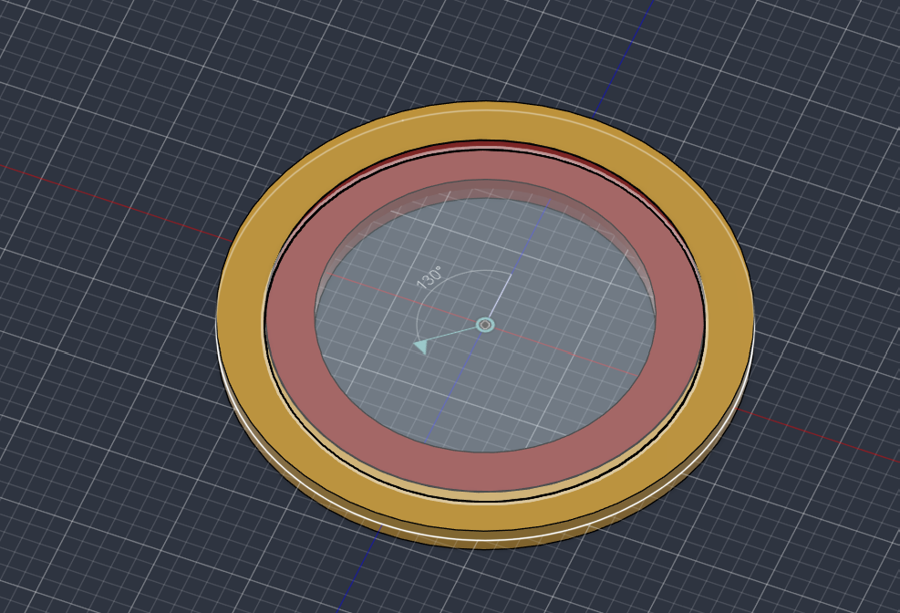

# Rapport de séance – Projet bras robotique autonome

| | |
|---|---|
| **Auteur** | Timothée Deroussin |
| **Date** | Vendredi 6 novembre 2026 |
| **Durée** | 4 heures |

## Objectif de la séance

L'objectif de cette séance était de faire avancer la conception 3D de notre bras robotique autonome. Avant de dessiner les pièces du bras, il est nécessaire de disposer des modèles 3D de tous les composants qui seront intégrés au robot. Ces modèles permettent de concevoir les pièces autour de composants aux dimensions réelles, puis de vérifier l'assemblage complet (encombrements, fixations, positionnement).

Ma partie de la séance a porté sur la modélisation de deux composants qui n'existaient pas sous forme de fichier 3D : le roulement de la plateforme rotative et la carte de commande des servomoteurs.

## Partie 1 : échange avec le professeur de CAO

Au début de la séance, nous avons échangé avec M. Lebreton, notre professeur de CAO, sur la conception du robot. Nous lui avons présenté notre projet et nos premiers choix, puis nous avons discuté des solutions à adopter pour la modélisation :

- la démarche à suivre : modéliser d'abord les composants achetés, puis concevoir les pièces du bras autour d'eux ;
- l'organisation de l'assemblage, afin de pouvoir vérifier plus tard que toutes les pièces s'ajustent correctement.

Cet échange nous a permis de partir sur une démarche de modélisation claire et de nous répartir le travail : mon collègue s'est occupé des schémas du bras et de la recherche des modèles 3D existants, tandis que je me suis chargé de modéliser les composants dont aucun modèle n'était disponible.

## Partie 2 : modélisation du roulement « Lazy Susan »

La base du bras repose sur une plateforme rotative, qui permet au bras de tourner autour de l'axe vertical. Cette rotation est assurée par un roulement de type « Lazy Susan » : deux plaques séparées par des billes, qui supportent la charge du bras tout en tournant librement.

Aucun modèle 3D correspondant exactement à notre roulement n'était disponible. Je l'ai donc modélisé à partir de mesures relevées directement sur la pièce réelle : diamètres, épaisseur et position des trous de fixation.

La précision de ce modèle est importante, car c'est sur lui que seront dessinées la base fixe et la plateforme rotative. La position des trous de fixation, en particulier, conditionne l'emplacement des inserts M4 prévus sur la base.

*Figure 1 : modèle 3D du roulement Lazy Susan (modélisé à partir de mesures)*

## Partie 3 : modélisation de la carte de commande des moteurs

Les servomoteurs Feetech STS3215 du bras sont pilotés par une carte de commande, qui fait le lien entre la Raspberry Pi et les moteurs. Cette carte devra être fixée sur la base du robot.

Comme pour le roulement, aucun modèle 3D de cette carte n'était disponible. Je l'ai modélisée à partir des dimensions indiquées par le vendeur sur la page AliExpress du produit : dimensions de la carte, position des trous de fixation et emplacement des principaux connecteurs.

Ce modèle permettra de prévoir dans la base un emplacement adapté pour la carte, avec ses fixations, tout en laissant l'accès aux connecteurs pour le câblage des moteurs et de l'alimentation.

*Figure 2 : modèle 3D de la carte de commande des servomoteurs (d'après les dimensions du vendeur)*

## Bilan et suite

Cette séance a permis de compléter la bibliothèque de composants 3D du projet. Avec les modèles trouvés par mon collègue (servomoteur STS3215, Raspberry Pi 4, module caméra) et le capteur infrarouge qu'il a modélisé, tous les composants principaux du robot sont désormais disponibles en 3D.

La prochaine étape sera de concevoir les pièces du bras et de la base autour de ces composants, en commençant par la base et la plateforme rotative montée sur le roulement, puis de réaliser l'assemblage complet afin de valider que tout s'ajuste correctement.
