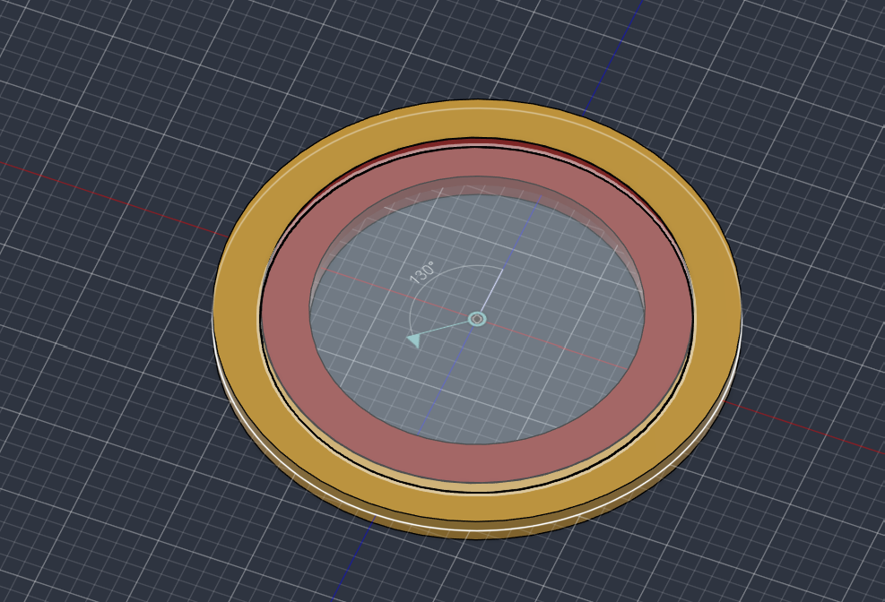
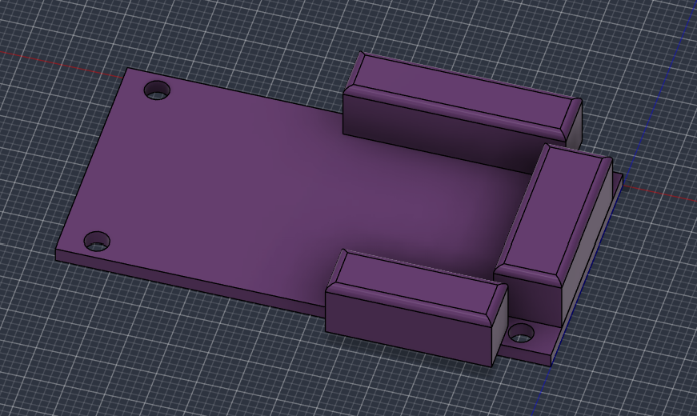

# Compte rendu de séance – 06/11/2026

**Durée :** 4 h  
**Intervenant :** M. Lebreton (enseignant de CAO)

## 1. Échange avec l'enseignant

La séance a débuté par un échange avec M. Lebreton au sujet du projet. Les choix de conception ont été présentés et les solutions à adopter pour la modélisation 3D du robot ont été discutées, afin de définir une démarche de modélisation cohérente avant l'assemblage complet.

## 2. Modélisation des composants

- **Roulement  lazy Susan :** modélisé à partir de mesures relevées sur la pièce réelle. Et ajout des liaisons sur la pièce. Il assure la rotation de la plateforme sur laquelle repose le bras.
- **Carte de commande des servomoteurs :** modélisée à partir des dimensions fournies sur AliExpress, afin de prévoir son emplacement et sa fixation sur le bâti.

*Figure 1 : modèle 3D du roulement*

*Figure 2 : modèle 3D de la carte de commande des moteurs*

## 3. Bilan

Les deux composants sont modélisés et prêts à être intégrés à l'assemblage. 
