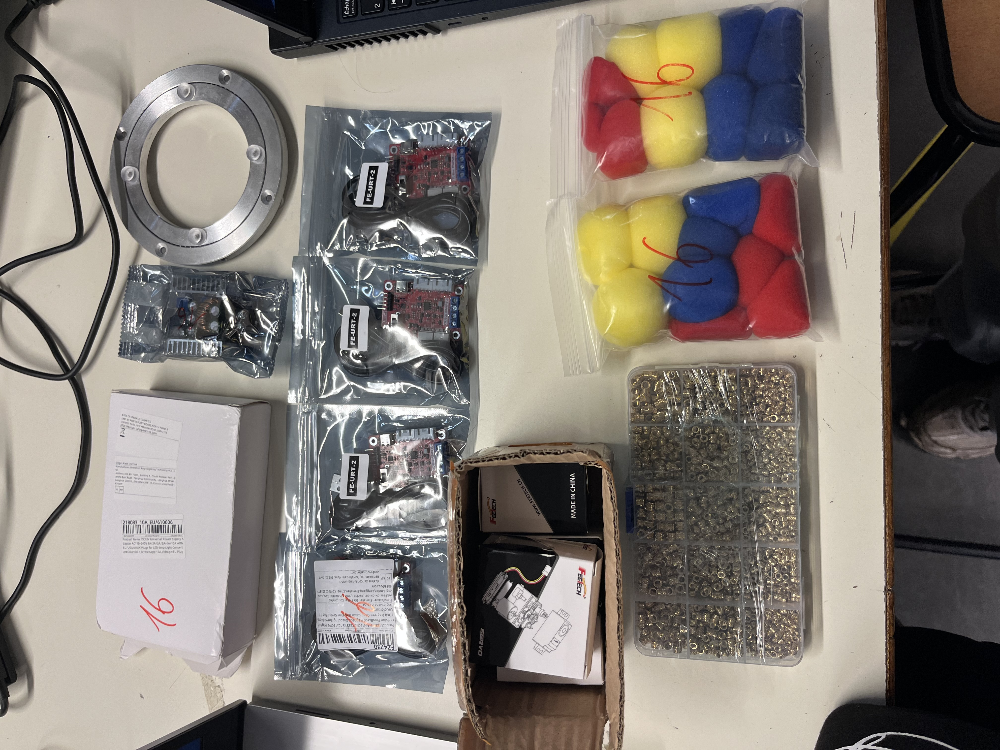
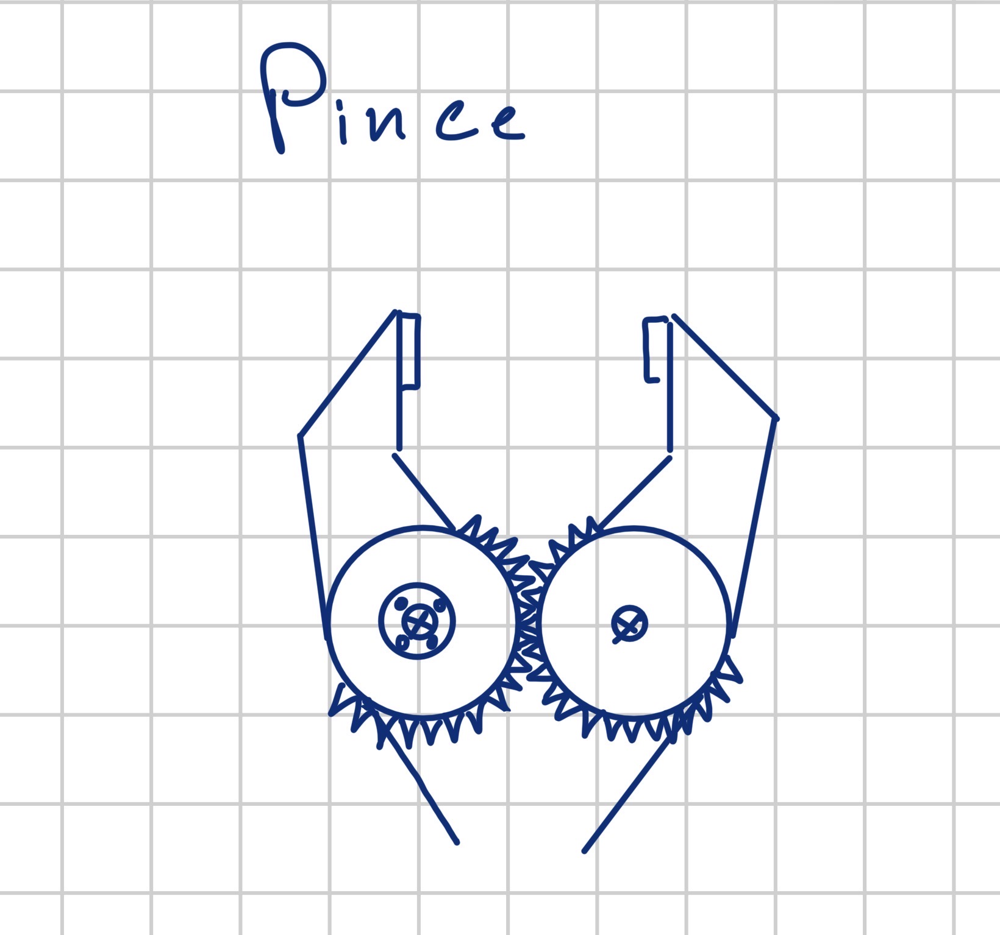
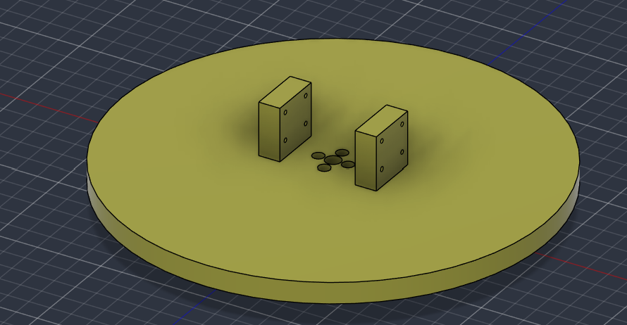
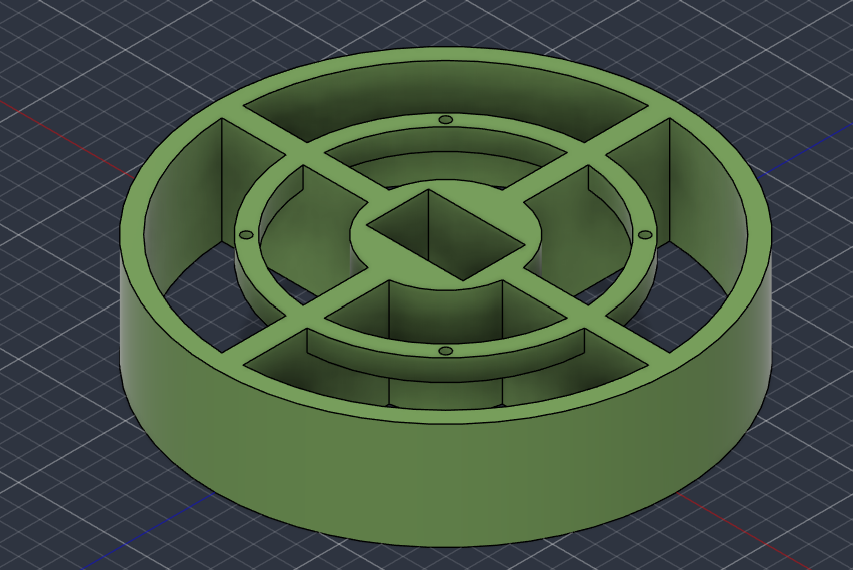
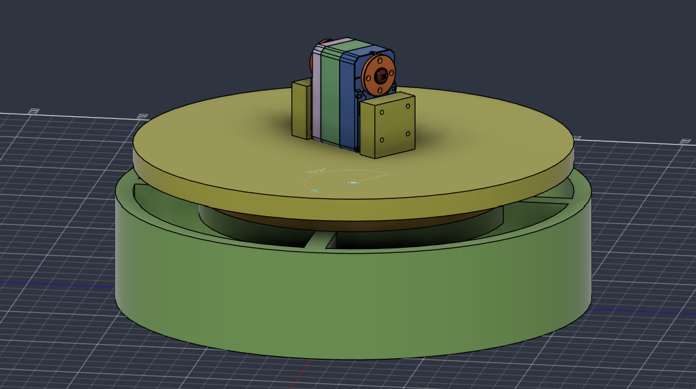

# Rapport de séance 3 – Projet bras robotique autonome

| | |
|---|---|
| **Date** | Mardi 17 novembre 2026 |
| **Durée** | 4 heures |

## Objectif de la séance

L'objectif de cette séance était de poursuivre la conception de la base du robot :

- imaginer le principe de fonctionnement de la pince ;
- terminer le bâti ;
- réaliser un premier assemblage de la base.

## Partie 1 : réception du matériel

En début de séance, nous avons reçu une partie du matériel commandé :

- les 4 servomoteurs et leurs cartes de commande FE-URT-2 ;
- les balles que le robot devra ramasser ;
- des inserts filetés, pour visser les composants ;
- l'alimentation 12 V ;
- un module convertisseur de tension DC-DC, qui servira à adapter la tension d'alimentation.

Le roulement Lazy Susan avait déjà été reçu auparavant.

*Figure 1 : matériel reçu en début de séance*

Avoir les moteurs en main nous a permis de vérifier leurs dimensions réelles et leurs fixations, ce qui a conduit à plusieurs modifications des pièces (voir parties 3 et 4).

## Partie 2 : croquis de la pince

J'ai ensuite réalisé un croquis pour imaginer la forme et le fonctionnement de la pince.

Le principe retenu repose sur deux roues dentées qui engrènent l'une avec l'autre :

- la première roue est entraînée directement par un servomoteur ;
- en tournant, elle entraîne la seconde roue dans le sens opposé ;
- chaque roue est solidaire d'une mâchoire de la pince.

Les deux mâchoires se ferment donc en même temps et de manière symétrique, avec un seul moteur. Ce système permet de saisir la balle en la centrant naturellement entre les deux mâchoires.

*Figure 2 : croquis de principe de la pince à deux roues dentées*

## Partie 3 : modification du plateau tournant

Après réception des moteurs, nous nous sommes rendu compte que le plateau tournant ne pouvait pas être vissé sur le moteur qui l'entraîne. J'ai donc modifié la pièce :

- les trous de fixation traversent maintenant tout le plateau, ce qui permet de passer les vis depuis le dessus ;
- les diamètres des trous ont été ajustés, après avoir été mesurés sur les pièces reçues.

*Figure 3 : plateau tournant modifié, avec les trous de fixation traversants*

## Partie 4 : nouvelle version du bâti

J'ai ensuite repris le bâti. Contrairement à la séance précédente, cette nouvelle version est réalisée en une seule pièce, mais elle a été conçue pour que toutes les fixations restent accessibles :

- une paroi extérieure cylindrique ;
- une couronne intérieure percée, sur laquelle se fixe le roulement ;
- des nervures qui relient la couronne à la paroi et rigidifient l'ensemble, tout en laissant de grandes ouvertures pour accéder aux vis ;
- un logement central dans lequel le moteur qui entraîne le plateau vient s'encastrer.

*Figure 4 : nouvelle version du bâti en une seule pièce, avec logement du moteur*

## Partie 5 : assemblage de la base

Enfin, j'ai réalisé l'assemblage 3D des composants de la base :

- le bâti ;
- le moteur du bâti, encastré dans son logement ;
- le roulement Lazy Susan ;
- le plateau tournant ;
- le moteur fixé sur le plateau tournant, entre les deux supports.

*Figure 5 : assemblage de la base (bâti, roulement, plateau tournant et moteurs)*

Cet assemblage permet de vérifier que les pièces s'emboîtent correctement et que les moteurs trouvent bien leur place.

## Bilan et suite

La réception du matériel a permis de corriger le plateau tournant et de concevoir une nouvelle version du bâti, plus simple, qui permet de fixer tous les composants. La base du robot est maintenant assemblée en 3D, et le principe de fonctionnement de la pince est défini.

L'objectif de la prochaine séance sera de modéliser la pince, de réaliser un assemblage d'ensemble avec les composants réalisés par mon camarade. Et de commencé à imprimer (peut-être via des patrons dans un premier temps) pour vérifier que tout s'agence correctement.
