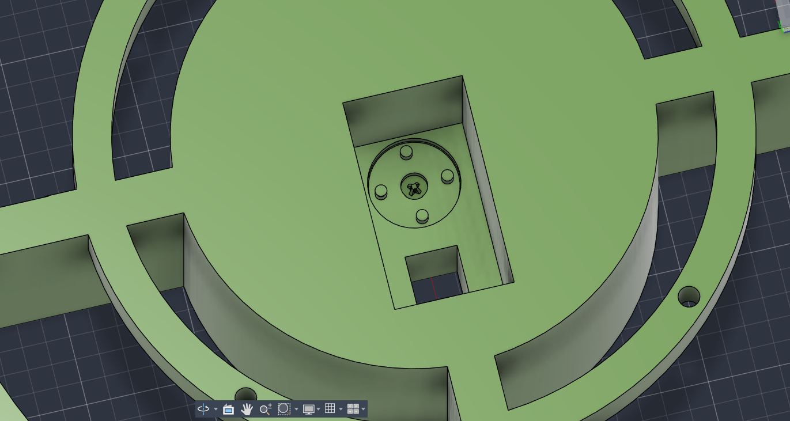
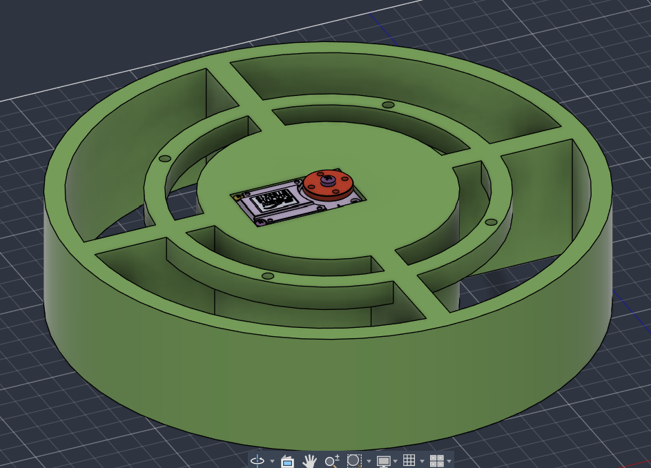
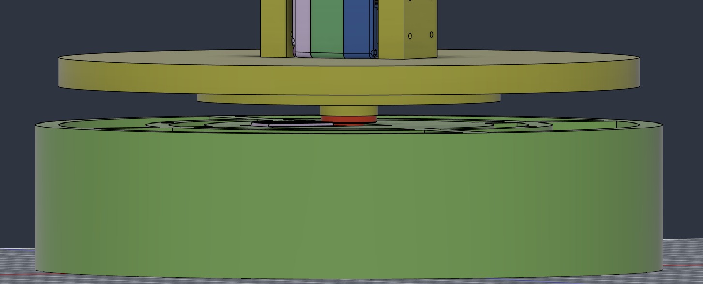
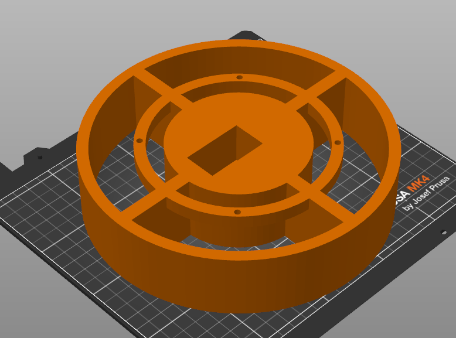

# Rapport de séance 4 – Projet bras robotique autonome

| | |
|---|---|
| **Date** | Mardi 24 novembre 2026 |
| **Durée** | 4 heures |

## Objectif de la séance
Au début de la séance je me suis rendu compte d'un problème d'intégration du moteur dans le bâti.
L'objectif de cette séance était de finaliser la base du robot afin de pouvoir commencer l'impression des pièces :

- adapter le bâti au moteur réel ;
- refaire l'assemblage de la base ;

La conception de la pince, prévue initialement dans mes tâches, est finalement prise en charge par mon camarade.

## Partie 1 : modification du bâti

### Logement du moteur

Le logement prévu pour le moteur dans le bâti a été redimensionné afin que le moteur puisse s'y insérer correctement. Un léger jeu a été ajouté autour du moteur pour lui permettre de rentrer dans son logement.

*Figure 1 : logement du moteur dans le bâti, avec jeu de montage*

### Ouverture sous le moteur

J'ai également créé une ouverture sous le logement du moteur. Elle permet le passage des câbles du moteur vers l'électronique ;

## Partie 2 : nouvel assemblage de la base

J'ai ensuite refait l'assemblage complet de la base avec le bâti modifié :

Cet assemblage permet de vérifier que le moteur est bien placé et que son axe est aligné avec le roulement et le plateau et bien en contact avec celui-ci.

*Figure 2,3 : assemblage de la base avec le bâti modifié*

## Partie 3 : lancement de l'impression du plateau tournant

Le plateau tournant étant validé, j'ai préparé son fichier d'impression dans le slicer, puis lancé l'impression. Cette première pièce imprimée permettra de vérifier en conditions réelles les dimensions et les fixations.

*Figure 4 : plateau tournant préparé dans le slicer avant impression*

## Bilan et suite

Le bâti est maintenant adapté au moteur réel, avec un logement ajusté et une ouverture pour les câbles qui garantit aussi l'alignement du moteur avec le roulement et le plateau. L'assemblage de la base a été mis à jour et l'impression du plateau tournant est lancée.

La prochaine étape sera de vérifier le plateau imprimé sur les composants réels, de corriger les cotes si nécessaire, puis d'imprimer le bâti. Ainsi que le bras.
